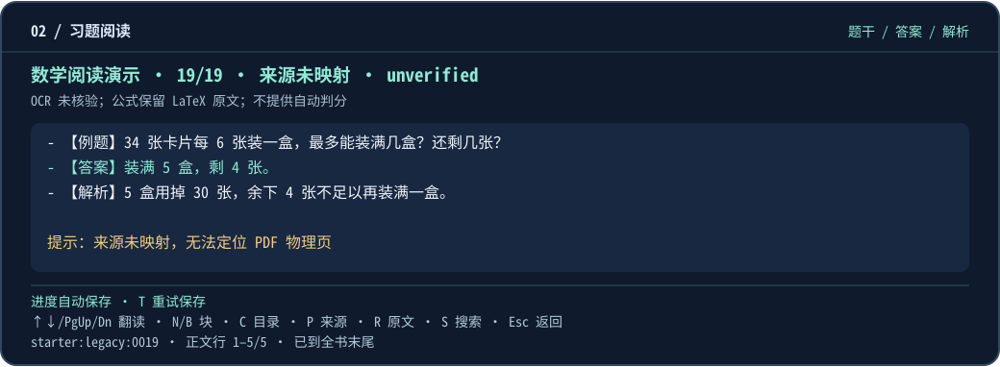
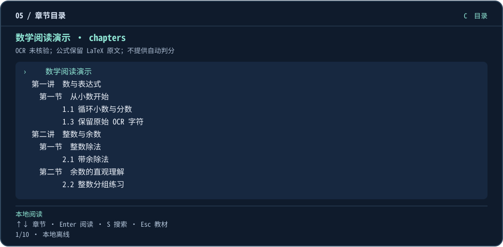
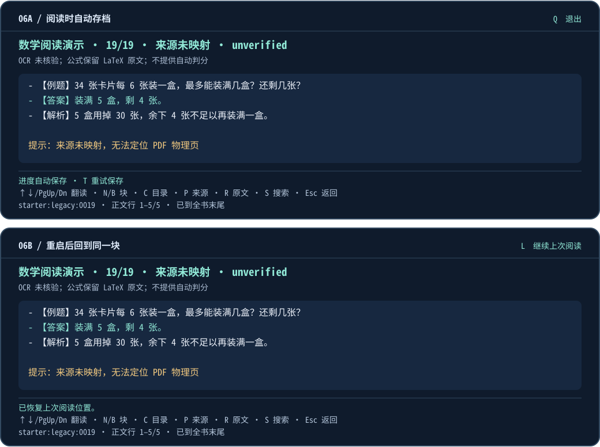
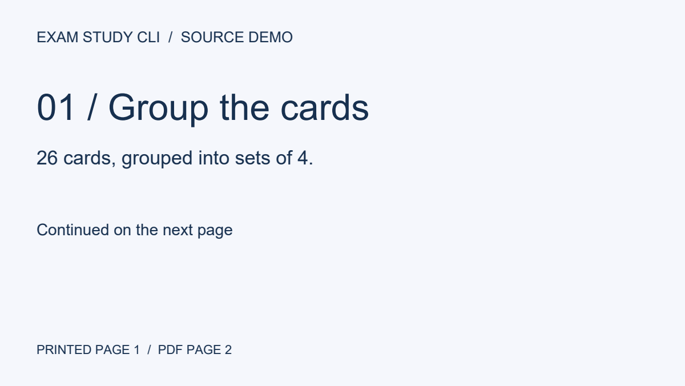
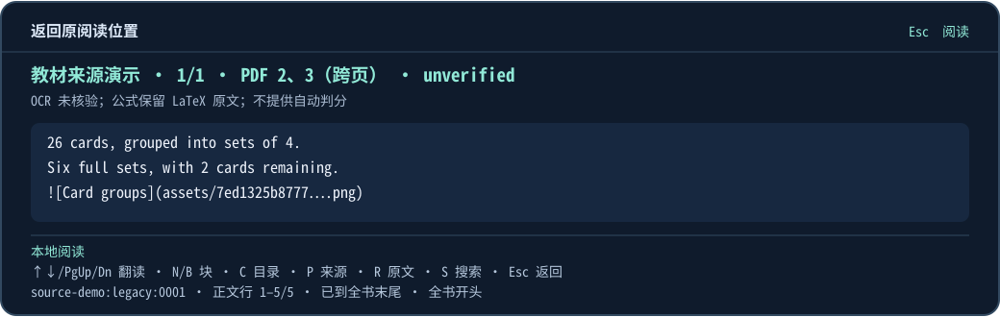
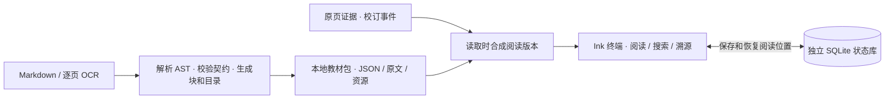

# Exam Study CLI

**把散落的 Markdown 与 OCR 笔记，变成可搜索、可溯源、可续读的离线教材。**

`TypeScript` · `React + Ink` · `SQLite` · `Local-first`

> **开发预览 · 持续迭代中**：核心阅读链路已经可用，项目尚未开发完成。命令、数据格式和交互仍可能调整；OCR 内容默认未核验，不提供自动判分。

[快速开始](#快速开始) · [七个实机演示](#功能演示) · [技术设计](#技术设计)

## 为什么做这个项目

PDF 适合保存原貌，扫描件 OCR 适合搜索，但两者都不擅长回答三个日常问题：**我读到哪了？这段话来自哪一页？核对之后改了什么？** Exam Study CLI 把阅读、来源和校订放进同一个键盘优先的终端工作流，又把学习进度和教材正文分开存储。

| 能力 | 已实现的体验 |
| --- | --- |
| 键盘驱动的终端阅读 | 章节树、逐块导航、长段落滚动、窄屏重排；本地中文搜索结果可直接跳转。 |
| 可追溯的导入 | 有物理页证据时按页导入；合并 OCR 作为 Legacy Preview，明确显示“来源未映射”，不猜页码。 |
| 可逆的校订 | 登记原页与图像证据，查看校订候选、确认、撤销和历史；显示版本不覆盖原始 OCR。 |
| SQLite 断点续读 | 保存块内位置；受支持的内容更新后尝试重新定位，无法可靠定位时回到目录。 |
| 无服务部署 | 安装依赖后，导入、阅读、搜索和进度保存都在本机运行；不需要账户或联网服务。 |

## 快速开始

需要 **Node.js ≥ 22.16.0**、**pnpm 10.20.0** 和支持交互输入的终端。Windows 可用 PowerShell；以下命令也可在 Bash 中执行。

```sh
git clone https://github.com/Fat2man/exam-study-cli.git
cd exam-study-cli
pnpm install --frozen-lockfile
pnpm build
node dist/cli/index.js import --legacy examples/starter.md --id starter --title "数学阅读演示"
node dist/cli/index.js read starter 1.1
```

在阅读界面按 `C` 浏览目录、`S` 搜索、`P` 查看来源、`Q` 退出。示例没有绑定 PDF，所以会明确显示**来源未映射**。退出后执行 `node dist/cli/index.js resume starter` 继续阅读。

安装 pnpm、导入自己的教材、配置数据目录和常见故障，见 **[安装与使用指南](docs/getting-started.md)**。

## 功能演示

下图来自[原创演示教材](examples/starter.md)及自制 PDF 的实际 Ink 终端输出。图片重新排版，界面文字、块编号和状态来自程序运行。

### 01 · 纯文字阅读

用日常分组例子解释余数。方向键和翻页键可在长段落内滚动，也能继续翻到相邻内容块。


### 02 · 习题阅读

题干、答案和解析按教材原文一起展示。这里演示的是**习题内容阅读**，还不是交互题库，不支持作答、自动判分或折叠答案。



### 03 · 查看原文

按 `R` 对照导入时保留的原始内容与校订记录。此处示例没有校订，因此显示「暂无已确认校订」；按 `Esc` 返回阅读。


### 04 · 中文搜索

按 `S` 搜索「整数分组练习」，结果显示命中片段，按 `Enter` 跳到对应内容块。


### 05 · 章节目录

按 `C` 查看讲、节和知识点组成的分层目录，用方向键选择后按 `Enter` 跳转。



### 06 · 自动存档与断点续读

阅读习题时自动写入本地 SQLite。按 `Q` 退出后，新会话按 `L` 继续上次阅读。两张对照画面显示同一个内容块编号，并明确提示「已恢复上次阅读位置」。



### 07 · 查看来源

按 `P` 查看当前内容块来自哪一页。自制 PDF 的第一页是封面，示例内容块跨 **物理页 2–3**，对应 **印刷页 1–2**。界面显示每页对应的原文区间、映射依据及原始文本快照；来源已登记，不代表内容已核验。


#### G · 打开原页图

打开当前选中的**整页图像**。下图是已登记的 PDF 物理页 2，保留了页眉、正文和印刷页码；只有登记了原页图证据的来源才能这样打开。



#### 1–9 · 选择跨页来源

数字键选的是**当前块来源列表里的第几项**，不是 PDF 物理页码。下图按 `2` 把原页图从物理页 2 切到物理页 3，再按 `G` 打开选中的那一页。


#### O · 打开整个 PDF

把整份 PDF 交给系统查看器。下图是同一份 PDF 的封面；系统查看器不保证自动跳页，必要时按来源视图里的**物理页码**手动定位。


#### I · 打开正文插图

打开当前内容块引用的**独立图片**。下图仅保留卡片分组示意，不包含整页的标题和页码；这就是它与 `G` 原页图的区别。


#### Esc · 返回阅读

关闭来源视图，回到刚才的内容块和正文滚动位置，不用重新选择章节。



复现配图：在仓库根目录执行 `pnpm build`，准备带 `pypdfium2` 和 `Pillow` 的 Python 环境，再运行 `node scripts/render-readme-demos.mjs`（可用 `DEMO_PYTHON` 指定解释器）。终端图来自实测界面；打开文件的三张示例直接展示对应文件内容，不模拟系统查看器，也不读取已有个人进度。

## 技术设计



- **导入与阅读分离**：用统一的 Markdown AST 和 Zod 契约生成教材结构；导入先在同卷暂存，校验成功后再发布，拒绝覆盖同 ID 的教材。
- **溯源与内容分离**：原始快照、SHA-256 指纹和追加式校订事件分开维护。原文变动导致证据失效时，不继续套用旧校订。
- **终端界面与数据分离**：Ink 根据终端宽度计算当前块可见行；非交互终端提供简明预览。数学公式以 LaTeX 源文展示，不在显示层自动改写。

## 文档与开发

- [安装、操作与故障排查](docs/getting-started.md) · [架构](docs/architecture.md) · [教材包协议](docs/data-schema.md) · [进度保存与恢复](docs/progress.md)
- `pnpm dev` 启动开发版；`pnpm typecheck`、`pnpm lint`、`pnpm test` 和 `pnpm build` 分别检查类型、规范、行为与构建。
- 正在迭代：更完整的导入诊断、大教材性能与跨平台验证；题库和练习流程尚未实现。另需使用外部工具执行 OCR，再导入其输出。
- 公开仓库只提供源码、文档和原创示例，不包含第三方教材、原始扫描件或个人学习数据。
