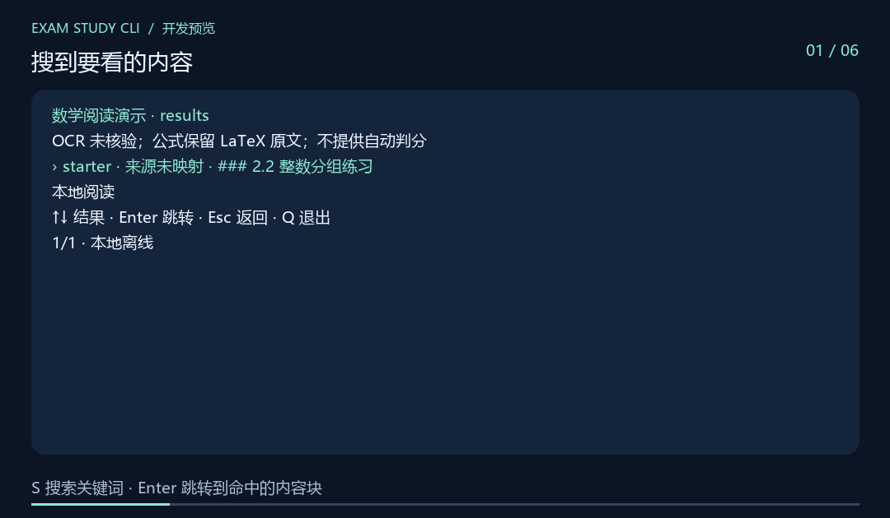
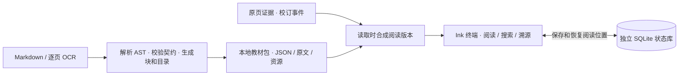

# Exam Study CLI

**在职备考，只有十分钟，也不用从「上次看到哪了」开始。**

Exam Study CLI 是一个离线终端阅读器。午休有几分钟，打开就能接着读；想复习某个考点，直接搜；遇到可疑的 OCR 文字或公式，还能回 PDF 原页核对。

> **开发预览 · 持续迭代中**：核心阅读链路已可用，项目尚未开发完成。OCR 内容默认未核验，不提供自动判分。

[看 20 秒演示](#20-秒首发演示) · [用自带样例试读](#快速开始) · [查看详细图文演示](docs/demo.md)

## 20 秒首发演示



从搜索考点，到核对 PDF 原页，再到退出后接着读。全程使用原创演示素材。

## 快速开始

需要 **Node.js ≥ 22.16.0**、**pnpm 10.20.0** 和支持交互输入的终端。Windows 可用 PowerShell；以下命令也可在 Bash 中执行。

```sh
git clone https://github.com/Fat2man/exam-study-cli.git
cd exam-study-cli
pnpm install --frozen-lockfile
pnpm build
node dist/cli/index.js import --legacy examples/starter.md --id starter --title "数学阅读演示"
node dist/cli/index.js read starter 1.1
```

在阅读界面按 `C` 浏览目录、`S` 搜索、`P` 查看来源、`Q` 退出。示例没有绑定 PDF，所以会明确显示**来源未映射**。退出后执行 `node dist/cli/index.js resume starter` 继续阅读。

安装 pnpm、导入自己的教材、配置数据目录和常见故障，见 **[安装与使用指南](docs/getting-started.md)**。

## 核心功能

| 能力 | 已实现的体验 |
| --- | --- |
| 键盘驱动的终端阅读 | 章节树、逐块导航、长段落滚动、窄屏重排；本地中文搜索结果可直接跳转。 |
| 可追溯的导入 | 有物理页证据时按页导入；合并 OCR 作为 Legacy Preview，明确显示“来源未映射”，不猜页码。 |
| 可逆的校订 | 登记原页与图像证据，查看校订候选、确认、撤销和历史；显示版本不覆盖原始 OCR。 |
| SQLite 断点续读 | 保存块内位置；受支持的内容更新后尝试重新定位，无法可靠定位时回到目录。 |
| 无服务部署 | 安装依赖后，导入、阅读、搜索和进度保存都在本机运行；不需要账户或联网服务。 |

想逐步查看按键和界面？见 [详细图文演示](docs/demo.md)，包含阅读、搜索、续读，以及来源视图的选页、原页图和插图操作。

## 技术设计



- **导入与阅读分离**：用统一的 Markdown AST 和 Zod 契约生成教材结构；导入先在同卷暂存，校验成功后再发布，拒绝覆盖同 ID 的教材。
- **溯源与内容分离**：原始快照、SHA-256 指纹和追加式校订事件分开维护。原文变动导致证据失效时，不继续套用旧校订。
- **终端界面与数据分离**：Ink 根据终端宽度计算当前块可见行；非交互终端提供简明预览。数学公式以 LaTeX 源文展示，不在显示层自动改写。

## 文档与开发

- [图文操作演示](docs/demo.md) · [安装、操作与故障排查](docs/getting-started.md) · [架构](docs/architecture.md) · [教材包协议](docs/data-schema.md) · [进度保存与恢复](docs/progress.md)
- `pnpm dev` 启动开发版；`pnpm typecheck`、`pnpm lint`、`pnpm test` 和 `pnpm build` 分别检查类型、规范、行为与构建。
- 正在迭代：更完整的导入诊断、大教材性能与跨平台验证；题库和练习流程尚未实现。另需使用外部工具执行 OCR，再导入其输出。
- 公开仓库只提供源码、文档和原创示例，不包含第三方教材、原始扫描件或个人学习数据。
