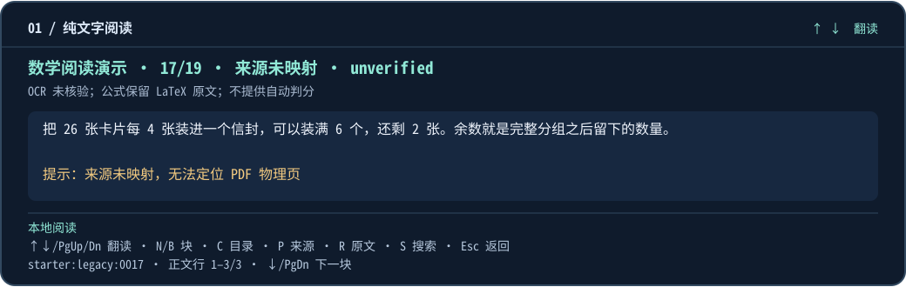
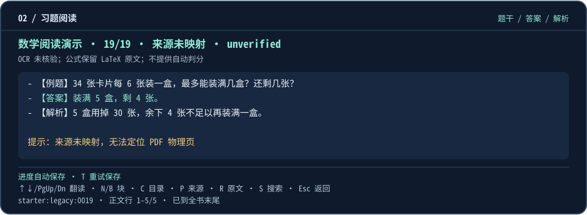
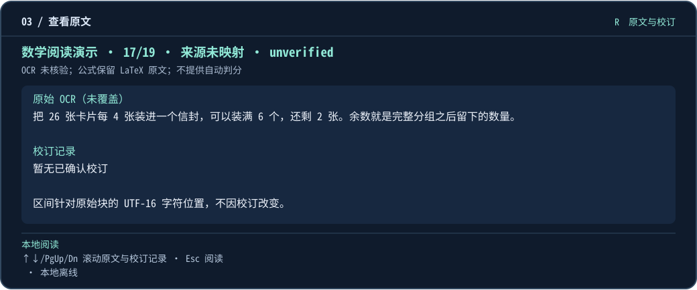
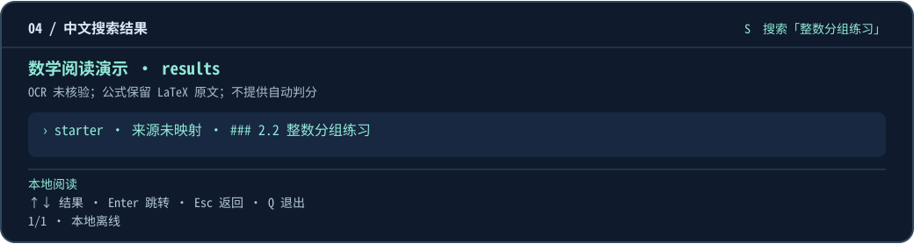
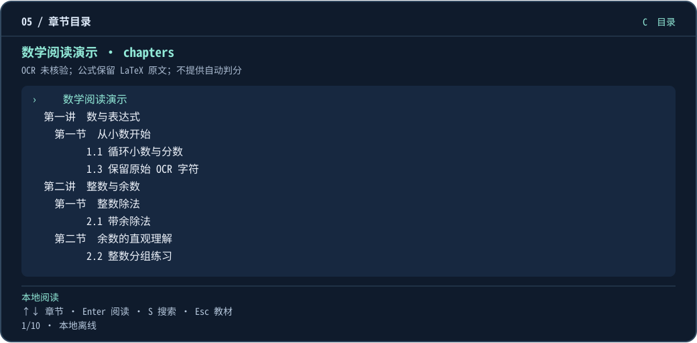
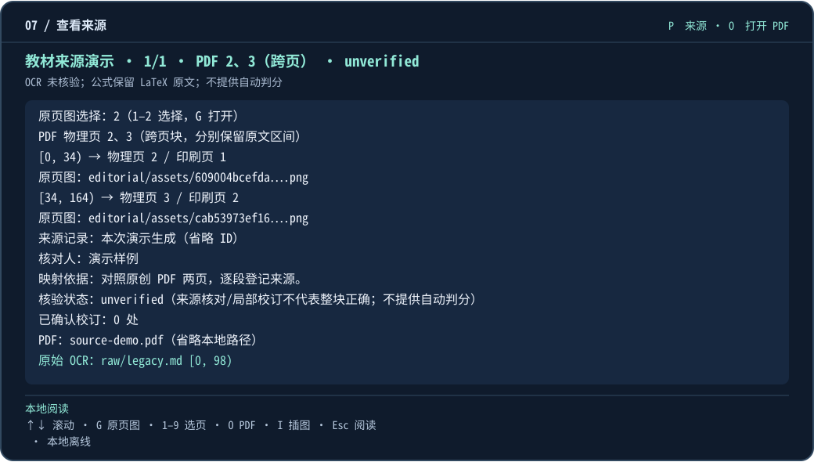
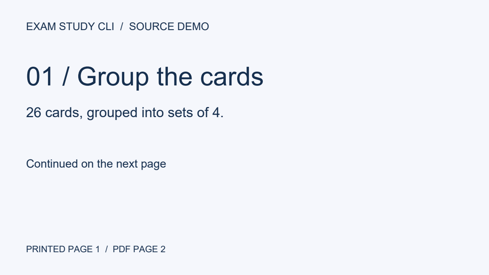
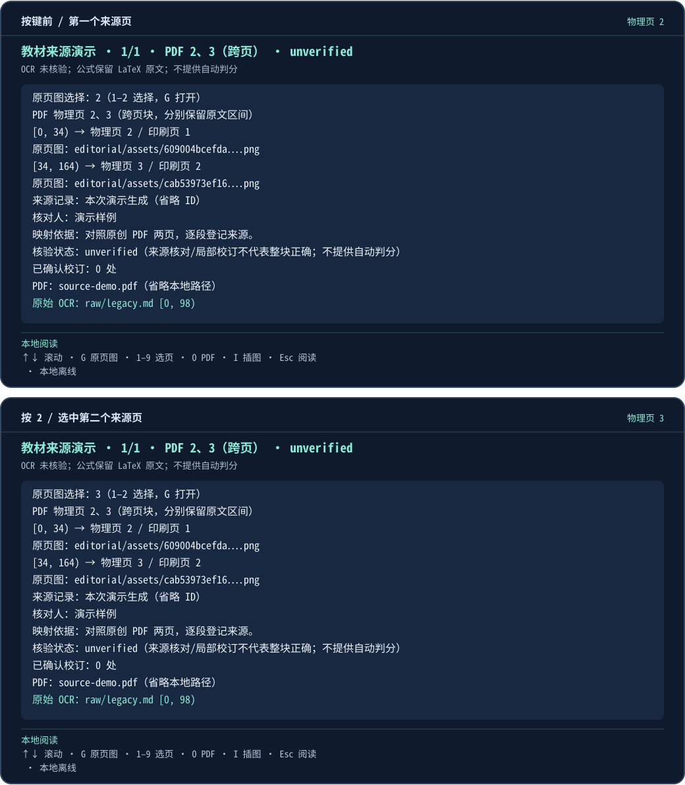
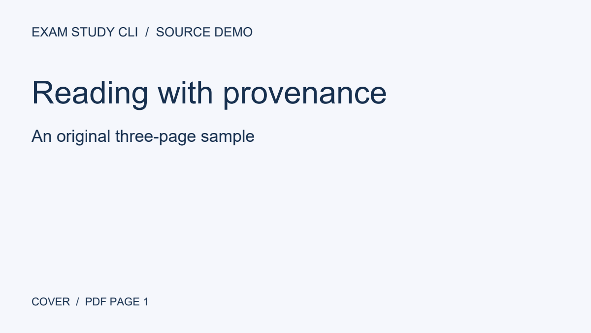
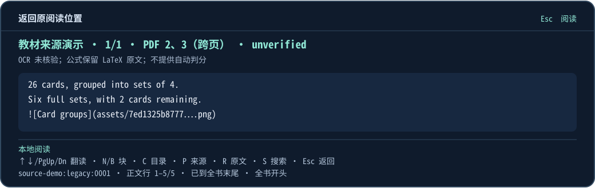

# 功能演示与按键说明

[返回项目首页](../README.md) · [安装与使用指南](getting-started.md) · [20 秒演示](../README.md#20-秒首发演示)

下图来自[原创演示教材](../examples/starter.md)及自制 PDF 的实际 Ink 终端输出。图片重新排版，界面文字、块编号和状态来自程序运行。

## 01 · 纯文字阅读

用日常分组例子解释余数。方向键和翻页键可在长段落内滚动，也能继续翻到相邻内容块。

## 02 · 习题阅读

题干、答案和解析按教材原文一起展示。这里演示的是**习题内容阅读**，还不是交互题库，不支持作答、自动判分或折叠答案。

## 03 · 查看原文

按 `R` 对照导入时保留的原始内容与校订记录。此处示例没有校订，因此显示「暂无已确认校订」；按 `Esc` 返回阅读。

## 04 · 中文搜索

按 `S` 搜索「整数分组练习」，结果显示命中片段，按 `Enter` 跳到对应内容块。

## 05 · 章节目录

按 `C` 查看讲、节和知识点组成的分层目录，用方向键选择后按 `Enter` 跳转。

## 06 · 自动存档与断点续读

阅读习题时自动写入本地 SQLite。按 `Q` 退出后，新会话按 `L` 继续上次阅读。两张对照画面显示同一个内容块编号，并明确提示「已恢复上次阅读位置」。

## 07 · 查看来源

按 `P` 查看当前内容块来自哪一页。自制 PDF 的第一页是封面，示例内容块跨 **物理页 2–3**，对应 **印刷页 1–2**。界面显示每页对应的原文区间、映射依据及原始文本快照；来源已登记，不代表内容已核验。

### G · 打开原页图

打开当前选中的**整页图像**。下图是已登记的 PDF 物理页 2，保留了页眉、正文和印刷页码；只有登记了原页图证据的来源才能这样打开。

### 1–9 · 选择跨页来源

数字键选的是**当前块来源列表里的第几项**，不是 PDF 物理页码。下图按 `2` 把原页图从物理页 2 切到物理页 3，再按 `G` 打开选中的那一页。

### O · 打开整个 PDF

把整份 PDF 交给系统查看器。下图是同一份 PDF 的封面；系统查看器不保证自动跳页，必要时按来源视图里的**物理页码**手动定位。

### I · 打开正文插图

打开当前内容块引用的**独立图片**。下图仅保留卡片分组示意，不包含整页的标题和页码；这就是它与 `G` 原页图的区别。

### Esc · 返回阅读

关闭来源视图，回到刚才的内容块和正文滚动位置，不用重新选择章节。

复现配图与动图：在仓库根目录执行 `pnpm build`，准备带 `pypdfium2` 和 `Pillow` 的 Python 环境，再运行 `node scripts/render-readme-demos.mjs`（可用 `DEMO_PYTHON` 指定解释器，非 Windows 用 `DEMO_FONT` 指定支持中文的字体文件）。终端图来自实测界面；打开文件的三张示例直接展示对应文件内容，不模拟系统查看器，也不读取已有个人进度。
